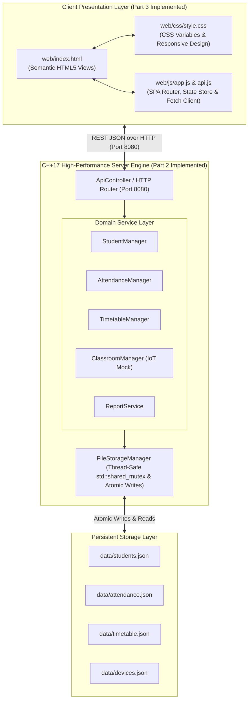

# Smart Classroom Management System

An engineering college mini-project featuring a high-performance **C++17 backend** and a modern, responsive **web graphical user interface** for smart classroom administration, student attendance tracking, weekly lecture scheduling, and simulated IoT classroom environmental monitoring.

---

## 📌 Project Overview

Traditional classroom management systems suffer from fragmented tools, error-prone manual paper attendance, and rigid schedules. The **Smart Classroom Management System** unifies:
1. **Executive Dashboard:** Live stats, attendance percentages, today's schedule, and environmental telemetry.
2. **Student Management:** Full CRUD with input validation, roll number uniqueness, and soft deletion to prevent corrupting historical records.
3. **Attendance Automation:** Daily rosters, idempotent attendance logging, defaulter identification (<75%), and percentage analytics.
4. **Timetable Scheduling:** Weekly lecture management with automatic collision detection.
5. **Smart Classroom IoT Simulation:** Real-time simulated temperature and occupancy telemetry, with controls for lighting, ventilation, and projection.
6. **Reports & Data Export:** Audit summaries, defaulter lists, and one-click CSV export for college authorities.
7. **Academic Documentation & Viva Guide:** Comprehensive project report blueprint and model viva answers.

---

## 🏛️ System Architecture



---

## 📁 Project Directory Structure

```text
Smart classroom mangement system/
│
├── CMakeLists.txt                 # Modern C++17 CMake build configuration
├── README.md                      # Primary project overview and instructions
│
├── docs/                          # Architectural and academic project documentation
│   ├── API.md                          # Complete REST API endpoint reference
│   ├── REQUIREMENTS_SPECIFICATION.md   # Functional and Non-Functional Requirements
│   ├── SYSTEM_ARCHITECTURE.md          # Layered architecture, diagrams & request lifecycle
│   ├── DATA_MODEL_SPECIFICATION.md     # Entities, schemas & soft deletion strategy
│   ├── TRACEABILITY_MATRIX.md          # Requirements Traceability Matrix (RTM)
│   ├── ROADMAP_PARTS_2_TO_5.md         # Staged implementation breakdown
│   └── ACADEMIC_REPORT_OUTLINE.md      # College mini-project report template & viva guide
│
├── include/                       # C++ Header declarations
│   ├── models/                    # Student, AttendanceRecord, TimetableEntry, ClassroomDevice
│   ├── services/                  # StudentManager, AttendanceManager, TimetableManager, ClassroomManager, ReportService
│   ├── storage/                   # FileStorageManager (thread-safe, atomic)
│   ├── controllers/               # ApiController (REST HTTP endpoints)
│   ├── utils/                     # Validation, ServiceResult, CsvExporter
│   └── third_party/               # Header-only single includes (nlohmann/json, cpp-httplib)
│
├── src/                           # C++ Source implementations
│   ├── main.cpp                   # Application entry point & HTTP daemon
│   ├── storage/                   # FileStorageManager.cpp
│   ├── services/                  # StudentManager, AttendanceManager, TimetableManager, ClassroomManager, ReportService
│   └── controllers/               # ApiController.cpp
│
├── web/                           # Graphical User Interface (SPA — Zero npm dependencies!)
│   ├── index.html                 # Main Single-Page Application interface
│   ├── css/
│   │   └── style.css              # Academic navy/blue theme, responsive design tokens
│   ├── js/
│   │   ├── api.js                 # Centralized C++ REST API client
│   │   └── app.js                 # SPA controller, event listeners, modal and toast managers
│   └── assets/                    # Icons and project assets
│
├── tests/                         # Automated verification test suite
│   └── test_backend.cpp           # 18 test scenarios covering business logic, validation & storage
│
└── data/                          # Persistent JSON flat-file storage
    ├── students.json              # 11 fictional student profiles (active & archived)
    ├── attendance.json            # Historical attendance logs
    ├── timetable.json             # Weekly lecture schedules
    └── devices.json               # Smart classroom IoT & sensor telemetry
```

---

## 🛠️ Build & Execution Instructions

### Prerequisites
- Modern C++17 compiler: **MinGW-w64** (GCC $\ge$ 8.0, Clang $\ge$ 7.0) or **MSVC 2019+** on Windows, or **g++ / clang++** on Linux/macOS.
- **CMake** ($\ge$ 3.16).
- A modern web browser (Google Chrome, Microsoft Edge, Mozilla Firefox).

### 1. Build using CMake
Open a terminal in the project root directory and execute:

```bash
# Configure the build directory
cmake -B build

# Compile both the server and test suite (using 4 parallel jobs)
cmake --build build -j 4
```

*Note on Windows:* If using MinGW:
```powershell
cmake -G "MinGW Makefiles" -B build
cmake --build build
```

---

### 2. Launch the Application Server & Open the Web UI
To launch the C++ REST API server on `http://127.0.0.1:8080`:

```powershell
# Windows
.\build\smart_classroom_server.exe --port 8080

# Linux / macOS
./build/smart_classroom_server --port 8080
```

Once running, open your web browser and navigate to:
```text
http://127.0.0.1:8080/
```
The browser will load the full administrative Single-Page Application directly from the C++ server.

---

### 3. Run the Automated Backend Tests
To run all 18 automated test scenarios in an isolated sandbox environment:

```powershell
# Windows
.\build\smart_classroom_tests.exe

# Linux / macOS
./build/smart_classroom_tests
```

**Expected Test Output:**
```text
=================================================================
   SMART CLASSROOM MANAGEMENT SYSTEM — BACKEND AUTOMATED TESTS   
=================================================================
 [PASS] 1. Add a valid student (Generated ID: std-012)
 [PASS] 2. Reject a student with missing required fields (Correctly rejected with 400)
 [PASS] 3. Reject a duplicate roll number (Returned 409 Conflict: A student with roll number 'cs2026-901' already exists.)
 [PASS] 4. Retrieve and search student records (Found matching roll CS2026-901)
 [PASS] 5. Update a student successfully (Updated name & division)
 [PASS] 6. Return an appropriate error for a nonexistent student (Returned 404 Not Found)
 [PASS] 7. Record attendance successfully (Marked PRESENT for 2026-10-21)
 [PASS] 8. Reject duplicate attendance for same student/date (Idempotent update without duplication)
 [PASS] 9. Calculate attendance percentages correctly (50.0% (defaulter) & 0.0% div-zero safe)
 [PASS] 10. Reject an invalid date or attendance status (Rejected invalid date and status)
 [PASS] 11. Create a valid timetable entry (Created slot tt-302 (14:00-15:30))
 [PASS] 12. Reject a conflicting classroom booking (Returned 409 Collision: Collision detected: Classroom 'Lab-101' is already booked on MONDAY from 14:00 to 15:30 for 'CS610: Cloud Computing'.)
 [PASS] 13. Update and delete timetable entries (Updated and deleted successfully)
 [PASS] 14. Update simulated device states (Toggled device power ON with level 2)
 [PASS] 15. Verify saved data remains available after restart (Record loaded from disk after reload)
 [PASS] 16. Deactivating student preserves historical attendance (Soft delete active=false, 2 history logs preserved)
 [PASS] 17. Verify invalid JSON produces proper error response (Response JSON has success=false, status=400)
 [PASS] 18. Report generation with empty and populated datasets (Tested populated and zero-data datasets safely)
=================================================================
   TEST SUMMARY: 18 PASSED, 0 FAILED (TOTAL: 18)
=================================================================
```

---

## 🎨 Frontend Views Overview

1. **Executive Dashboard (`#dashboard`):** 4 real-time KPI metric cards (Active Students, Today's Attendance %, Defaulters count, Classroom Telemetry), today's scheduled classes, quick IoT appliance overview, and live clock.
2. **Student Directory (`#students`):** Search by name or roll number, filter by status (`All`, `Active`, `Archived`), Register New Student modal, Edit modal, and safe Soft Deactivation with confirmation.
3. **Attendance Ledger (`#attendance`):** Interactive calendar date selector, student roster with Present/Absent toggle switches, "Mark All Present" & "Mark All Absent" shortcuts, live daily rate, and authoritative backend persistence.
4. **Lecture Timetable (`#timetable`):** Weekly tabs (`ALL`, `MONDAY`–`SATURDAY`), Schedule Lecture Slot modal, start < end time validation, and automatic collision detection rejecting overlaps with 409 Conflict alerts.
5. **Smart Classroom IoT (`#classroom`):** Ambient temperature gauge, live room occupancy counter, and interactive switches for lights, ventilation fans, and smart interactive projector with real-time C++ synchronization.
6. **Reports & Analytics (`#reports`):** Defaulters list (<75% attendance threshold) highlighted in red/amber badges, student-wise overall attendance ledger, and one-click CSV download buttons.
7. **About Project (`#about`):** Comprehensive academic project brief, architectural breakdown, hardware roadmap for Arduino/ESP32, and model viva answers.

---

## 🚀 5-Part Staged Roadmap Status

- [x] **Part 1:** Requirements Analysis, System Architecture, Data Models & Project Scaffolding *(Completed)*
- [x] **Part 2:** C++ Domain Models, JSON Storage Manager, Business Services, REST API & Automated Tests *(Completed)*
- [x] **Part 3:** Frontend Development, Responsive Single-Page UI & C++ REST API Integration *(Completed)*
- [x] **Part 4:** Integration Testing, Dashboard Enhancement (attendance_trend, latest_attendance), Edge Case Verification — 18/18 Tests Pass *(Completed)*
- [x] **Part 5:** Submission Package — Project Report, Presentation, Demo Guide, Viva Q&A (40 Q&A), Test Results, Quick Reference *(Completed)*

---

## 📦 Submission Package

All submission documents are in the `submission/` folder:

| Document | Description |
|----------|-------------|
| `submission/PROJECT_REPORT.md` | Full college mini-project report (fill [PLACEHOLDER] fields) |
| `submission/PRESENTATION.md` | 13-slide presentation outline |
| `submission/DEMO_GUIDE.md` | Step-by-step 5–8 minute live demo script |
| `submission/VIVA_QA.md` | 40 Q&A pairs across 8 categories |
| `submission/TEST_RESULTS.md` | Actual test output (18/18 pass + integration tests) |
| `submission/QUICK_REFERENCE.md` | One-page desk reference for demo day |
| `submission/SUBMISSION_CHECKLIST.md` | Final checklist before submission |
