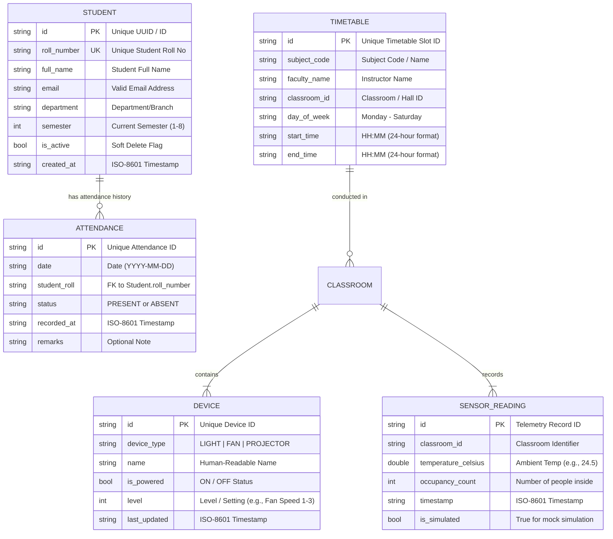

# Smart Classroom Management System — Data Model Specification

## 1. Data Models & Entity Relationships

The data layer is modeled using strongly-typed C++17 domain structures. All entities have clear primary identifiers, validation constraints, and serialization mappings to lightweight JSON storage.



---

## 2. Entity Specifications

### 2.1 Student Entity (`Student`)
Represents an enrolled student in the institution.

| Field Name | C++ Type | Constraints & Validation Rules | Description |
| :--- | :--- | :--- | :--- |
| `id` | `std::string` | Non-empty, unique internal GUID/ID | System primary key |
| `roll_number` | `std::string` | Unique, alphanumeric, 4–20 characters, non-empty | Official roll/registration number (e.g., `CS2026-042`) |
| `full_name` | `std::string` | 2–80 characters, alphabets and spaces only | Student's full name |
| `email` | `std::string` | Valid email format (`name@domain.ext`) | Contact email address |
| `department` | `std::string` | Non-empty, e.g., `Computer Science & Engineering` | Academic branch |
| `semester` | `int` | Integer between `1` and `8` | Current semester |
| `is_active` | `bool` | Default `true` | Soft deletion status flag |
| `created_at` | `std::string` | ISO 8601 (`YYYY-MM-DDTHH:MM:SSZ`) | Record creation timestamp |

#### C++ Domain Definition:
```cpp
struct Student {
    std::string id;
    std::string roll_number;
    std::string full_name;
    std::string email;
    std::string department;
    int semester{1};
    bool is_active{true};
    std::string created_at;
};
```

#### JSON Representation (`data/students.json`):
```json
{
  "students": [
    {
      "id": "std-001",
      "roll_number": "CS2026-001",
      "full_name": "Aarav Sharma",
      "email": "aarav.sharma@college.edu",
      "department": "Computer Science",
      "semester": 6,
      "is_active": true,
      "created_at": "2026-10-01T09:00:00Z"
    }
  ]
}
```

---

### 2.2 Attendance Entity (`AttendanceRecord`)
Represents an individual student's attendance entry for a given calendar date.

| Field Name | C++ Type | Constraints & Validation Rules | Description |
| :--- | :--- | :--- | :--- |
| `id` | `std::string` | Non-empty primary key | e.g., `att-20261021-CS2026-001` |
| `date` | `std::string` | Format `YYYY-MM-DD`, valid calendar date | Academic session date |
| `student_roll` | `std::string` | Must match an existing `Student.roll_number` | Foreign key reference |
| `status` | `std::string` | Value in `{"PRESENT", "ABSENT"}` | Attendance status |
| `recorded_at` | `std::string` | ISO 8601 timestamp | Timestamp when recorded/updated |
| `remarks` | `std::string` | Optional, max 120 characters | Reason for absence or notes |

#### Uniqueness & Referential Integrity Rule:
The pair `(date, student_roll)` forms a composite unique business constraint. Re-submitting attendance for the same student on the same date will **update** the status rather than creating a duplicate entry.

#### C++ Domain Definition:
```cpp
struct AttendanceRecord {
    std::string id;
    std::string date;
    std::string student_roll;
    std::string status; // "PRESENT" or "ABSENT"
    std::string recorded_at;
    std::string remarks;
};
```

#### JSON Representation (`data/attendance.json`):
```json
{
  "records": [
    {
      "id": "att-20261021-CS2026-001",
      "date": "2026-10-21",
      "student_roll": "CS2026-001",
      "status": "PRESENT",
      "recorded_at": "2026-10-21T09:30:00Z",
      "remarks": "On time"
    }
  ]
}
```

---

### 2.3 Student Deletion & Historical Integrity Strategy

> [!IMPORTANT]
> **The Soft Deletion Architectural Pattern:**
> Deleting a student via hard deletion (`DELETE FROM students WHERE id = ...`) leads to dangling foreign keys or forces cascading deletion of historical attendance logs. Cascading deletion is unacceptable in an academic institution because past attendance sheets for completed months would become mathematically altered or corrupted.
>
> **Solution Adopted:**
> 1. When a user requests student deletion, the C++ `StudentService` sets `student.is_active = false`.
> 2. The student is immediately removed from the **active roster** and cannot be selected for future attendance sessions.
> 3. Historical attendance records retain their valid foreign key `student_roll`.
> 4. Historical reports for past dates continue to display the student's name and historical records with a subtle badge (`(Inactive/Alumni)`).
> 5. An optional administrative feature to completely purge an inactive student is only permitted if that student has zero associated historical attendance records.

---

### 2.4 Timetable Entry Entity (`TimetableEntry`)
Represents a scheduled lecture slot in the weekly academic calendar.

| Field Name | C++ Type | Constraints & Validation Rules | Description |
| :--- | :--- | :--- | :--- |
| `id` | `std::string` | Non-empty primary key | Slot ID (e.g., `tt-mon-1`) |
| `subject_code` | `std::string` | Non-empty, 2–50 chars | e.g., `CS601: Distributed Systems` |
| `faculty_name` | `std::string` | Non-empty, 2–60 chars | e.g., `Dr. Priya Nair` |
| `classroom_id` | `std::string` | Non-empty, e.g., `Room-304` | Classroom or Lab identifier |
| `day_of_week` | `std::string` | In `{"Monday", "Tuesday", "Wednesday", "Thursday", "Friday", "Saturday"}` | Scheduled day |
| `start_time` | `std::string` | Valid 24-hr format `HH:MM` | Class start time |
| `end_time` | `std::string` | Valid 24-hr format `HH:MM`, `end_time > start_time` | Class finish time |

#### Collision Detection Rules:
Before adding or modifying an entry, the `TimetableService` evaluates:
$$\text{Collision} \iff \text{day} = \text{slot.day} \land \text{room} = \text{slot.room} \land \max(\text{start}_1, \text{start}_2) < \min(\text{end}_1, \text{end}_2)$$

#### JSON Representation (`data/timetable.json`):
```json
{
  "schedule": [
    {
      "id": "tt-001",
      "subject_code": "CS601 - Operating Systems",
      "faculty_name": "Prof. R. Sen",
      "classroom_id": "Room-302 (Smart Lab)",
      "day_of_week": "Wednesday",
      "start_time": "09:30",
      "end_time": "10:30"
    }
  ]
}
```

---

### 2.5 Smart Classroom Device & Sensor Telemetry (`ClassroomState`)
Represents the IoT state of the physical or simulated classroom.

| Field Name | C++ Type | Constraints & Description |
| :--- | :--- | :--- |
| `device_id` | `std::string` | Unique identifier (e.g., `dev-light-1`, `dev-fan-1`, `dev-proj-1`) |
| `device_type` | `std::string` | `LIGHT`, `FAN`, `PROJECTOR` |
| `name` | `std::string` | Descriptive display title |
| `is_powered` | `bool` | Current operational power state (`true` = ON, `false` = OFF) |
| `level` | `int` | Level / Setting (0 for OFF, 1–3 for Fan Speed, 1080p for Projector) |
| `temperature_celsius`| `double` | Ambient classroom temperature in Celsius (simulated: 20.0°C – 32.0°C) |
| `occupancy_count` | `int` | Live count of persons present in room ($$\ge 0$$) |
| `is_simulated` | `bool` | Set to `true` (ready to be toggled to `false` when hardware connected) |

#### JSON Representation (`data/devices.json`):
```json
{
  "classroom_id": "CR-302",
  "temperature_celsius": 24.2,
  "occupancy_count": 32,
  "is_simulated": true,
  "devices": [
    {
      "id": "dev-lights-main",
      "device_type": "LIGHT",
      "name": "Main LED Arrays",
      "is_powered": true,
      "level": 1
    },
    {
      "id": "dev-fans-all",
      "device_type": "FAN",
      "name": "Ceiling Ventilation Fans",
      "is_powered": true,
      "level": 2
    },
    {
      "id": "dev-projector-main",
      "device_type": "PROJECTOR",
      "name": "Smart Interactive Projector",
      "is_powered": false,
      "level": 0
    }
  ]
}
```
