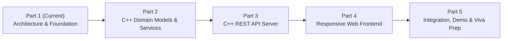

# Staged Implementation Plan (Parts 1 to 5)

This 5-part engineering roadmap structures the incremental development of the **Smart Classroom Management System**. Each part produces a testable, reviewable milestone without skipping architectural integrity.

---

## Part 1: Requirements Analysis, Architecture & Project Foundation (Current Stage)
* **Goal:** Establish formal requirements, clean architecture, data schemas, traceability matrix, folder scaffolding, and initial CMake configuration.
* **Key Deliverables:**
  - Complete software requirements and non-functional specifications.
  - Multi-tier system architecture and sequence diagrams.
  - C++ data models, schema definitions, and soft-delete strategy.
  - Requirements Traceability Matrix (RTM).
  - Clean project folder tree and initial `CMakeLists.txt`.
  - Realistic seed JSON schemas in `data/`.

---

## Part 2: Backend Core Models, Persistence Layer & Business Logic Services
* **Goal:** Implement the heart of the C++ backend—the domain entities, thread-safe JSON file storage manager, and core business services.
* **Key Tasks:**
  1. **Domain Headers & Structs:** `Student.hpp`, `AttendanceRecord.hpp`, `TimetableEntry.hpp`, `ClassroomDevice.hpp`.
  2. **JSON Serialization:** Integrate modern C++ JSON serialization/deserialization methods (`to_json` / `from_json`).
  3. **FileStorageManager (Repository):**
     - Thread-safe read/write using `std::shared_mutex`.
     - Atomic file replacement (`.tmp` write followed by `std::filesystem::rename`).
     - Automated creation of default data files if absent.
  4. **Domain Services:**
     - `StudentService`: Validation, duplicate roll number check, CRUD, soft deletion (`is_active = false`).
     - `AttendanceService`: Recording attendance, duplicate prevention per date, calculating individual and aggregate attendance percentages, defaulter detection (<75%).
     - `TimetableService`: Schedule CRUD, time parsing (`HH:MM`), interval collision detection.
     - `ClassroomService`: Device state toggling (lights, fans, projector), simulated sensor fluctuation engine (temperature, occupancy).
     - `ReportService`: Summaries and CSV formatting engine.
  5. **Unit Verification:** Minimal test driver to verify services operate independently of the web server.

---

## Part 3: C++ REST API Routing, HTTP Server & Endpoints
* **Goal:** Expose business logic through clean, standardized RESTful HTTP endpoints using the C++ web framework (Crow / cpp-httplib).
* **Key Tasks:**
  1. **C++ Web Server Setup:** Configure HTTP daemon on port `8080` (with static asset file delivery for `web/`).
  2. **Controller Implementation:**
     - `StudentController`: `GET /api/students`, `POST /api/students`, `PUT /api/students/:id`, `DELETE /api/students/:id`.
     - `AttendanceController`: `GET /api/attendance?date=...`, `POST /api/attendance/mark`, `GET /api/attendance/summary`.
     - `TimetableController`: `GET /api/timetable`, `POST /api/timetable`, `DELETE /api/timetable/:id`.
     - `ClassroomController`: `GET /api/classroom/status`, `POST /api/classroom/device/toggle`, `POST /api/classroom/sensor/update`.
     - `ReportController`: `GET /api/reports/defaulters`, `GET /api/reports/export-csv`.
  3. **Error Handling & Middleware:** Uniform JSON error responses (`{"status": "error", "message": "..."}`) and HTTP status codes (`400`, `404`, `409`, `500`).
  4. **API Integration Testing:** Command-line `curl` or automated HTTP script tests verifying round-trip JSON requests and persistence.

---

## Part 4: Frontend Development (Modern Web Dashboard UI)
* **Goal:** Build a responsive, professional graphical user interface in HTML5, CSS3, and JavaScript that communicates seamlessly with the C++ backend.
* **Key Tasks:**
  1. **UI Layout & Navigation:** Sidebar navigation, top header, status indicators, and clean card containers.
  2. **Dashboard View (Module A):** Metric counters, today's schedule preview, IoT classroom status badge, and activity log.
  3. **Student Management View (Module B):** Data table with live search/filter, registration modal, edit modal, and confirmation dialog for deletion.
  4. **Attendance Roster View (Module C):** Interactive calendar date picker, student list with Present/Absent toggle switches, "Mark All Present" shortcut, and real-time daily percentage indicator.
  5. **Timetable View (Module D):** Weekly calendar grid view with "Add Lecture Slot" dialog and collision warning banners.
  6. **Smart Classroom IoT View (Module E):** Temperature gauge, live room occupancy counter, and interactive switches for lights, fans, and projector with real-time feedback.
  7. **Reports & Export View (Module F):** Defaulters table (highlighting <75%), summary charts/bars, and one-click "Download Attendance CSV" button.
  8. **API Connector (`api.js`):** Modular client-side REST wrapper handling errors, loading states, and toast notifications.

---

## Part 5: Integration, Testing, Seed Data & Viva Defense Preparation
* **Goal:** Finalize end-to-end integration, seed realistic demonstration data, run comprehensive end-to-end testing, and prepare documentation for college presentation.
* **Key Tasks:**
  1. **End-to-End System Testing:** Verify every user journey from browser action to disk persistence across server restarts.
  2. **Fictional Seed Data:** Pre-populate 15 realistic student records, 2 weeks of sample attendance logs, and a full semester timetable.
  3. **Performance & Robustness Checks:** Test edge cases (invalid dates, duplicate roll numbers, malformed payloads).
  4. **Comprehensive College Project Report:** Produce the academic report following the university outline (Abstract, System Architecture, Viva Q&A, Future Scope).
  5. **Demonstration Guide:** Step-by-step presentation script showing the teacher/evaluator how modern C++ powers the local web application.
