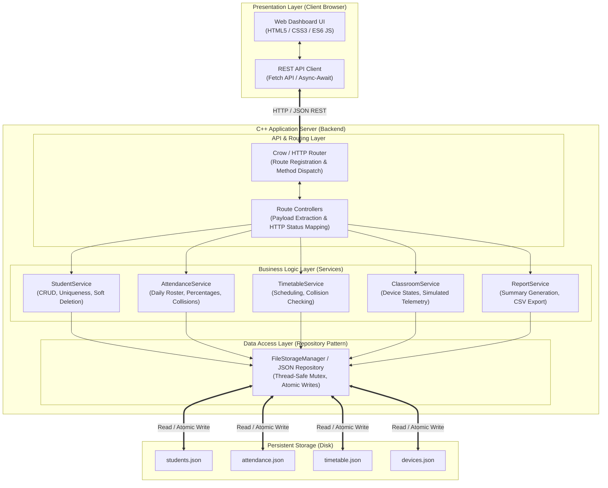
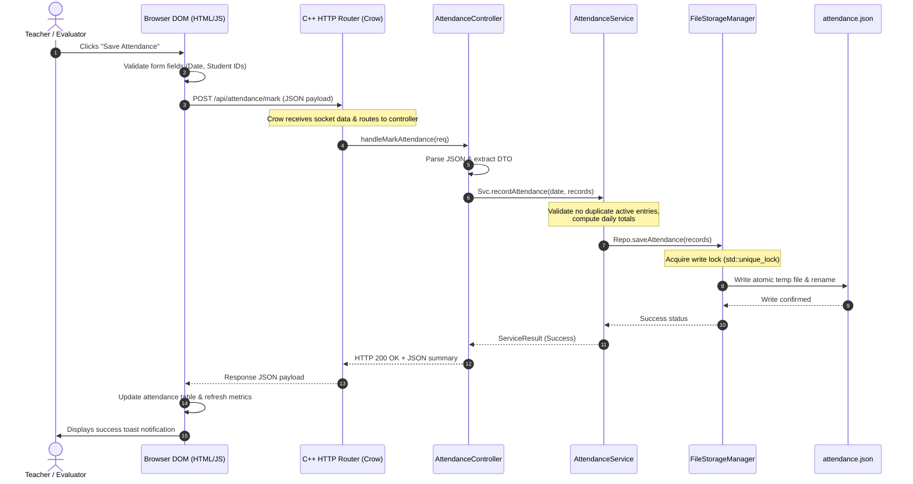

# Smart Classroom Management System — System Architecture

## 1. Architectural Overview & Design Philosophy

The **Smart Classroom Management System** is designed using a **Clean, Layered Architecture** following Object-Oriented Design (OOD) and SOLID principles. The system enforces strict separation of concerns, decoupling presentation from core domain business rules and persistence mechanisms.

---

## 2. Layer-by-Layer Detailed Breakdown

### Layer 1: Presentation Layer (Frontend)
* **Technology:** Semantic HTML5, Modular CSS3 (Design Tokens via CSS Variables, Flexbox/Grid), Modern Vanilla ES6+ JavaScript.
* **Responsibilities:**
  - Rendering responsive views: Dashboard, Student Directory, Attendance Sheet, Timetable Grid, IoT Monitoring Panel, and Reports.
  - Client-side input pre-validation (validating email patterns, non-empty fields, positive numeric values).
  - Asynchronous HTTP communication with the backend using the native browser `fetch()` API.
  - Reactive DOM updates and toast notifications without requiring page reloads (Single-Page Application feel).
* **Design Decision:** Zero external heavy frameworks (no React/Angular/Vue, no Node.js/npm build steps). This guarantees that the project has zero external npm dependencies, starts instantaneously, and can run on any college laboratory computer.

### Layer 2: API & Routing Layer (C++ Web Server)
* **Technology:** Crow C++ Web Framework (or header-only `cpp-httplib` + `nlohmann/json`).
* **Responsibilities:**
  - Listening for HTTP requests on `http://127.0.0.1:8080`.
  - Static file serving for the frontend web assets (`index.html`, CSS, JavaScript files).
  - Parsing incoming HTTP request bodies (`application/json`) and query parameters.
  - Parameter sanitization and structure validation before delegating to services.
  - Serializing domain models and service responses into JSON format.
  - Returning standardized HTTP status codes (`200 OK`, `201 Created`, `400 Bad Request`, `404 Not Found`, `409 Conflict`, `500 Internal Error`).

### Layer 3: Business Logic Layer (Domain Services)
* **Technology:** Pure Modern C++17 Classes.
* **Responsibilities:**
  - **`StudentService`:** Enforces business rules such as roll number uniqueness, name validation, email formatting, and soft deletion (`is_active` toggle).
  - **`AttendanceService`:** Enforces one record per student per date, calculates overall and student-wise attendance percentages, detects defaulters (<75%), and compiles daily statistics.
  - **`TimetableService`:** Validates time bounds (`StartTime < EndTime`), prevents double-booking of rooms or instructors.
  - **`ClassroomService`:** Maintains state of simulated devices (lights, fans, projector), updates environmental readings (temperature, occupancy), and provides hooks for IoT hardware communication.
  - **`ReportService`:** Aggregates analytics, formats tabular report payloads, and serializes CSV data streams for download.

### Layer 4: Data Access / Storage Layer (Repository Pattern)
* **Technology:** Modern C++17 (`std::filesystem`, `std::fstream`, `std::shared_mutex`).
* **Responsibilities:**
  - Abstracting disk I/O behind repository interfaces (`IStudentRepository`, `IAttendanceRepository`, etc.).
  - Thread-Safe Operations: Utilizing reader-writer locks (`std::shared_mutex` with `std::shared_lock` for concurrent reads and `std::unique_lock` for writes).
  - **Atomic Persistence:** When saving data, writing first to a temporary file (`filename.tmp`) and atomically renaming it (`std::filesystem::rename`) to the target file. This prevents file corruption if power or server is interrupted during a write operation.

### Layer 5: Testing Layer
* **Technology:** Modular test suites using modern C++ assertions and an automated test runner script.
* **Responsibilities:**
  - Unit tests for validation functions, percentage calculations, timetable collision detection, and serialization.
  - Integration tests verifying HTTP endpoint responses and storage persistence across restarts.

---

## 3. Technology Stack Selection & Academic Justification

| Component | Selected Technology | Alternative Considered | Justification & Viva Talking Points |
| :--- | :--- | :--- | :--- |
| **Language** | **C++17** | C++11, C++14, C | Provides modern features (`std::optional`, `std::string_view`, `std::filesystem`, structured bindings) enabling safe, memory-leak-free, modern OOP code without old C-style pointers. |
| **Web Framework** | **Crow C++** (with `cpp-httplib` modular compatibility) | Boost.Beast, Oat++, Drogon | Crow provides an intuitive, expressive route syntax (`CROW_ROUTE`), built-in JSON, and static asset serving with minimal configuration. It avoids heavyweight ORM overhead while remaining fast and easy to understand during viva. |
| **JSON Library** | **nlohmann/json** | RapidJSON, JsonCpp | `nlohmann/json` is the de facto industry standard for modern C++, offering intuitive Python-like syntax (`j["name"] = student.name`), robust parsing error handling, and header-only integration. |
| **Build Tool** | **CMake (>= 3.16)** | Makefiles, Visual Studio `.sln` | CMake is cross-platform, generator-independent, and handles dependency fetching seamlessly via `FetchContent`. Works equally well on MinGW, GCC, Clang, and MSVC. |
| **Frontend** | **Vanilla HTML5 / CSS3 / ES6** | React, Vue, Angular | Zero dependency footprint. No `npm install`, no build pipelines, no Node.js runtime required. The C++ server directly serves the static web bundle, demonstrating pure engineering simplicity. |
| **Data Storage** | **JSON Flat-File with Atomic Writes** | SQLite, MySQL, PostgreSQL | Perfectly matches college mini-project scope. Zero setup/database configuration for the evaluator. Data files can be directly opened in VS Code or Notepad to demonstrate real-time backend updates. |

---

## 4. End-to-End Request/Response Lifecycle

The following sequence illustrates the complete round-trip lifecycle of an API call—such as marking student attendance:

### Explanation for College Viva:
1. **User Action:** The user triggers an event in the browser.
2. **Client Validation:** JavaScript validates date and selection prior to network transmission, reducing unnecessary network round-trips.
3. **Transport:** The request is serialized as an HTTP `POST` with `Content-Type: application/json` over TCP loopback.
4. **Route Dispatching:** The C++ Crow server identifies the registered URI pattern and executes the corresponding controller function.
5. **Business Logic Execution:** The controller delegates to `AttendanceService`, which verifies that the date is valid, checks if attendance was already recorded for that student on that date, and updates the state.
6. **Thread-Safe Atomic Persistence:** The repository acquires a mutex lock, serializes the updated list to `attendance.json.tmp`, and performs an atomic filesystem replace.
7. **Response & DOM Refresh:** The backend responds with an HTTP status code and a JSON response. The frontend updates the dashboard cards and displays a feedback toast.
